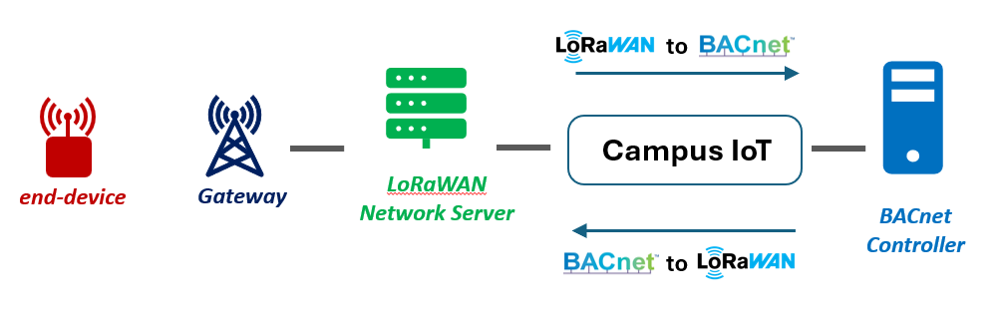
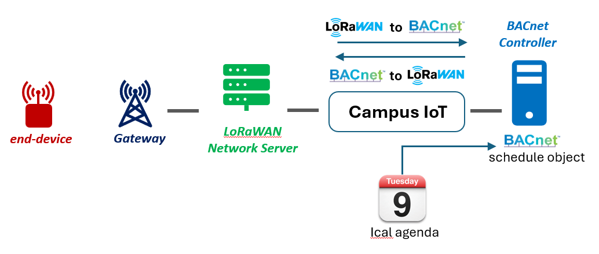
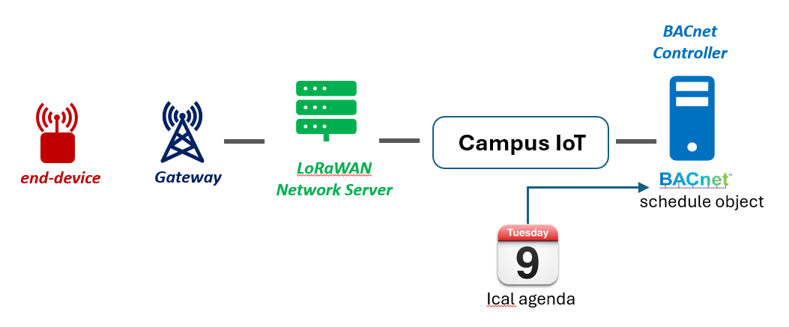

# Campus-IoT, an open-source platform for Smart Buidling management

Campus-IoT is a web application that has 3 main features :
1. it writes your **LoRaWAN end-devices** payload on your **BACnet BMS**. it also reads **BACnet objects on your BMS** to send it to your **LoRaWAN end-devices**. Why is it useful ? Please refer to my [webinar on this topic](https://youtu.be/LRaT3Jc7xrs?si=O3qf1RE9En45UXKb).



2. It controls the **LoRaWAN actuators** with any **ical agenda**. Because it's important to control your LoRaWAN actuator's setpoints (thermostatic valves, HVAC) according the room occupency.



3. It configures any **BACnet schedule object** on any **BACnet BMS** from an **ical agenda**. Because too many BACnet controllers have a static weekly schedule, we want to provide an easy way to directely write the BACnet schedule object.  




## **1. Overview**
### **1.1. Key Features**
Campus IoT acts as a bridge between **LoRaWAN end-devices** and **BACnet controllers**, making it ideal for **smart building applications**.

#### **Key Features for the LoRaWAN to BACnet interface**

- **Universal Compatibility:**
  - [x] Works with **all LoRaWAN end-devices** and **gateways**.
  - [x] Supports **ChirpStack**, **Actility**, and **The Things Stack** (The Things Network / The Things Industries) Network Servers.
  - [x] Integrates with **all BACnet controllers** using native BACnet protocols (and/or Rest API when using **Distech-Controls controllers**).

- **Bidirectional Communication:**
  - [x] **Uplink:** Writes LoRaWAN payloads to specific BACnet objects.
  - [x] **Downlink:** Writes BACnet objects to specific LoRaWAN payload.

- **Proven Use Cases:**
  - [x] Thermostatic valves
  - [x] Temperature and humidity sensors
  - [x] Air quality sensors
  - [x] Current monitoring sensors
  - [x] Pilot wired electric heater controller

#### **Key Features for controlling LoRaWAN actuators with ical agenda**
  - [x] Dynamically creates schedule object on the BMS as well as special events according to the ical agenda.
  - [x] Works with any URL providing an ical agenda 

#### **Key Features configuring BACnet schedule object from ical agenda**
  - [x] Write special event on a remote BACnet schedule event from an ical agenda.

for the last 2 features, working with ical agenda is **Highly configurable:**
  - [x] **Schedule output:** configure the value when the zone is occupied/unoccupied.
  - [x] **Anticipation and inertia:** when you need to heat a room before its occupation.
  - [x] **Merge:** if you want to provide a merged time slot of all daily event.
  - [x] **Discard:** if you want to discard specific event in the ical agenda.
  - [x] **Weekly event:** if you want to add a weekly event configuration on top of the special event.


### **1.2. What Makes Campus IoT Unique?**
Campus IoT is designed with a **different approach** compared to other LoRaWAN-BACnet interfaces. Here’s why it stands out:

1. **BACnet Client Architecture:**
   - Unlike most interfaces that act as **BACnet servers**, LoRaBAC operates as a **BACnet client**. It only interacts with the controller when a LoRaWAN payload is received, reducing unnecessary traffic.

2. **Flexible Deployment:**
   - LoRaBAC can be installed **anywhere**:
     - On the **LoRaWAN Gateway**
     - On any industrial PC within the **local network**
     - Directly on the **BMS**

3. **Open Source and Free:**
   - LoRaBAC is **free to use** and **open-source** under the **MIT License**, offering full transparency and customization.

### **1.3. Quick Start with Docker:**
A pre-configured **Node-RED Docker image** is available on [Docker Hub](https://hub.docker.com/r/montagny/node-red/tags). It includes all required packages for easy deployment.


### **1.4. Support**
To get support on LoRaWAN or LoRaBAC, please refers to the following ressources, or [reach us](https://www.univ-smb.fr/lorawan/en/contact/) out.

:tv: Webinar Replay: [LoRaWAN and BACnet interfaces for Smart Building]()

:notebook: Free ebook:[LoRaWAN for beginers books](https://www.univ-smb.fr/lorawan/en/free-book/)

:tv: E-learning platform: [LoRaWAN for beginers videos](https://www.udemy.com/course/lora-lorawan-internet-of-things/?referralCode=21DED0F1021F4E261955)

:tv: E-learning platform for Advanced users: [LoRaWAN for Advanced users videos](https://www.udemy.com/course/lorawan-for-advanced-users/?referralCode=BA4A670560916E1AED77)

:bulb: 2 days training sessions: [LoRaWAN and IoT Training](https://www.univ-smb.fr/lorawan/avada_portfolio/formation-distanciel/)


## **2. Prerequisites**
### **2.1. LoRaWAN End-Device**
To use Campus IoT you will need:
- A LoRaWAN **Network Server** (ChirpStack, TTN or Actility).
- The device **LoRaWAN payload decoder** (for uplink).
- The device **LoRaWAN payload encoder** (for downlink, if needed).

Payload decoder and encoders should be provided by your device manufacturer.


#### **LoRaWAN device name convention**
Campus IoT handles automatic assignement between the LoRaWAN payload and the BACnet object. This assignement is based on the device number NUM given in the **LoRaWAN device name**. 

Here is the convention rules for naming LoRaWAN devices : 
  1. **End each device name with a hyphen and a number (NUM).**
  2. NUM must be greater than 0.

Good examples: mclimate-vicki-1, micropelt-mlr003-3, nexelec-flow-54, test-25, myDevice-36, my_Device-69.

Wrong examples: 
- mclimate-vicki (no number)
- mclimate-vicki-0 (NUM cannot be 0), 
- mclimate-vicki-one (not a number at the end),
- mclimate vicki-1 (contains a space).


### **2.2. MQTT Broker**
Campus IoT relies on an **MQTT broker** for communication. You can use:
- The built-in MQTT broker provided by **ChirpStack**, **Actility**, or **The Things Stack**.
- Your own **custom MQTT broker**.

### **2.3. BACnet controller**
Campus IoT writes to and read from an existing BACnet controller. If you don't have one, we provide a fully features BACnet server that complies with all BACnet service and with no limitation on number of objets.


## **3. Getting Started**
Campus IoT needs to run on the network host to be able to use the "who is" command for network discovery.

1. Run the following command on any hardware where docker is installed:
```bash
docker run -d \
  --name campus-iot \
  --network host \
  --restart unless-stopped \
  montagny/campus-iot:latest
```
2. Open <http://localhost:3000>

Alternativelly, you can directly use this application using npm :

```powershell
npm install
npm start
```


## **4. Campus IoT configuration**
The complete Campus IoT configuration is done is four steps :
1. MQTT connection
2. BMS connections
3. LoRaWAN To BACnet configuration
4. Zones & Schedules configuration

In this section, we will see only the first two parts : **"MQTT connections"** and **"BMS connections"**. **"LoRaWAN To BACnet"** and **"Zones & Schedules"** are optionnal and depends on your use case. See the corresponding chapter to get more information. 


### **4.1 Import/Export configuration**
If you have a ready to use configuration, use the "Import CONF" button. Your configuration will automatically apply after saving.


### **4.2 MQTT connections**
Campus IoT embeds a MQTT client (pub/sub). You need to provide:
- MQTT broker address/port
- Login
- Password
- Topic

MQTT connection settings are stored in `/data/mqtt-connections.json`

### **4.3 BMS connections**
Campus IoT is a BACnet client that writes to and read from BMS. We need to configure the BMS connection and protocol used. A who-is network discovery is available to easy the configuration process. We need to provide:
- A connection name for this BMS
- The BMS Ip Address on the local network
- The procole used (default is BACnet, but Respt API is available on some BMS)

Press the Test button to check the connection then save your configuration.

Use the "Get all Object" button to read all BACnet object on the BMS.

BMS connections settings are stored in `/data/bms-connections.json`

## **5. LoRaWAN To BACnet configuration**
The LoRaWAN to BACnet process is based on a device profile list. For example, if your use case has 200 thermostatic valves and 300  temperature sensors, then you need to configure 2 device profiles, one for the thermostatic valves and one for temperature sensors. 

LoRaWAN to BACnet configuration settings are stored in `/data/device-profiles.json`


#### **5.1. Device profile configuration:**
The device profile configuration has two steps. Most configuration are obvious. Please click on the tooltip icon (?) to get more information on a specific field.
  1. Device profile configuration 
  2. Mapping between LoRaWAN payload and BACnet objects. 

#### **Instance Num configuration**
Campus IoT handles automatic assignement (manual assignement is optionnal) between the LoRaWAN payload and the BACnet object. This assignement is based on the device number NUM given in the LoRaWAN device name (xxxxx-NUM).
* **First AV instance number**: This is where all BACnet Analog Value will be written for this device profile.
* **First BV instance number**: This is where all BACnet Binary Value will be written for this device profile.
* **Number of AV for each device**: This is the range allocated for the Analog Value for each device of this device profile.
* **Number of BV for each device**: This is the range allocated for the Binary Value for each device of this device profile.

So for example, the device **xxxxx-NUM** will write/read BACnet object from :
**First AV instance number** + (**Number of AV for each device** * **NUM**).

Where **NUM** is the device number. 

#### **Uplink or downlink**
The correspondance between LoRaWAN payload and BACnet objects has two possible "Directions": 
* **Uplink** means a mapping between a LoRaWAN payload and BACnet objects.
* **Downlink** means a mapping between a BACnet object and a LoRaWAN payload.

#### **Downlink strategies**
Please refer to the Appendix to know more about the downlink strategies proposed.


## **6. Zones & Schedules configuration**
Depending on your use case, there are two ways to configure this section
1. A agenda is written in a schedule BACnet object
2. A agenda is written in a schedule BACnet object AND it controls the downlink object of a LoRaWAN end-device.

The first use case (1) is when you have a LoRaWAN actuator (e.g : a LoRaWAN thermostatic valve). In that case, Campus IoT run the following process:
- dynamically creates a BACnet schedule object
- fills in this schedule object with special event based on a ical Agenda
- links the output of this schedule to the downlink payload that has to be sent to the LoRaWAN end-device.
- applies the downlink strategy to request downlink on the LoRaWAN device.

The second use case (2) is when you already have a BACnet schedule object on a BMS, and you want to fill it in with events from an ical agenda. The agenda can be a room occupency or a building accupency, depending on what the BMS controls. In that case, Campus IoT run the following process:
- fills in this schedule object with special event based on a ical Agenda (BACnet schedule object must be present on the BMS).


## APPENDIX A: **Downlink strategies**
Interfacing uplink LoRaWAN payload with BACNet object is quite simple, however it's more challenging to send downlink from BACnet object to LoRaWAN end-device as we need to define a strategy. The strategy describes when and how the downlink message should be sent.

Right now, in the LoRaBAC application, there are four dowlink strategies that can cover almost all use cases.  

### A.1. The **Compare with the following BACnet uplink object** strategy
On each uplink, the BACnet object value is compared to the BACnet object configured. 
* If the values are different, the object value is sent to the device with a downlink message.
* If the values are the same, no action is taken.

**Use case:** this strategy is usefull when using thermostatic valves that send the actual **setpoint**. Before sending a downlink the setpoint computed by the BMS is compared with the valve setpoint. If the values are different, the new setpoint is sent to the LoRaWAN valve.

### A.2. The **Compare with the following BACnet uplink object within range** strategy
On each uplink, the BACnet object value is compared to the BACnet object configured. 
* If the values are equal within the margin (range), than no action is taken.
* If the values are different and outside the margin (range), than a downlink is scheduled.

**Use case:** This strategy is usefull when using thermostatic valves that send the actual **room temperature measured by the valve**. For example, if we use an external temperature sensor for this room, we usually want to use it as the **real room temperature** (so the **room temperature measured by the valve** is discarded). Therefore, each time the **room temperature measured by the valve** is different from the **real room temperature**, the **real room temperature** is sent to the valve. 

But to reduce the number of downlink, we might want to discard downlink when the **room temperature measured by the valve** is close to the **real room temperature**. e.g: do we really need to update the **room temperature measured by the valve** if the **real room temperature** is different from only 0.2°C ? That's when we can use a range. A downlink is only sent when  temperatures are different +/- range.


### A.3. The **On change on BMS** strategy
On each uplink (or polling time for class C end-devices), the BACnet object value is compared to its previous value (from the previous downlink). 
* If the values are different, a downlink is scheduled.
* If the values are the same, no action is taken.

**Use case:** This strategy is usefull when using thermostatic valves that doesn't send its setpoint. Or when we use a class C end device that doesn't necessarily send uplink. In that case, campus IoT keeps track of the last value sent to the LoRaWAN device. If the BACnet object has changed, a LoRaWAN downlink is sent. 

### A.4. The **On change on BMS within range** strategy
On each uplink (or polling time for class C end-devices), the BACnet object value is compared to its previous value (from the previous downlink).
* If the values are equal within the margin (range), than no action is taken.
* If the values are different and outside the margin (range), than a downlink is scheduled.

**Use case:** This strategy is usefull when using thermostatic valves that doesn't send its setpoint. Or when we use a class C end device that doesn't necessarily send uplink. In that case, campus IoT keeps track of the last value sent to the LoRaWAN device. If the BACnet object has changed, a LoRaWAN downlink is sent, but only if the values are different and outside the margin (range).

## APPENDIX B: **Specific information about the Network Server**
Depending on the LoRaWAN Network Server, there might be some specific configurations.

### B.1. Details for actility (ThingPark):
When using downlink, ThingPark needs information to retrieve the payload encoder. In ThingPark, the payload decoder are called drivers and have 3 identifiers : pID, mID and ver.

### B.2. Details for ChirpStack:
When using downlink as well as the "Flush Downlink Queue" capability, LoRaBAC uses the ChirpStack's grpc API to flush the queue. Therefore, we need to provide the API Key generated by ChirpStack.  

